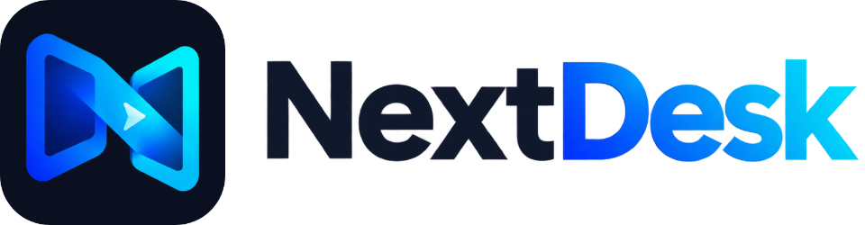
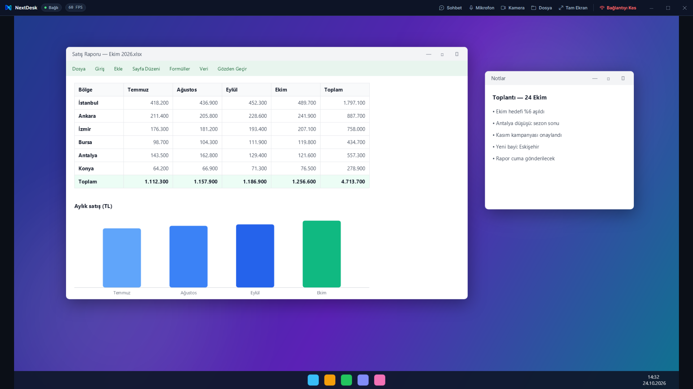
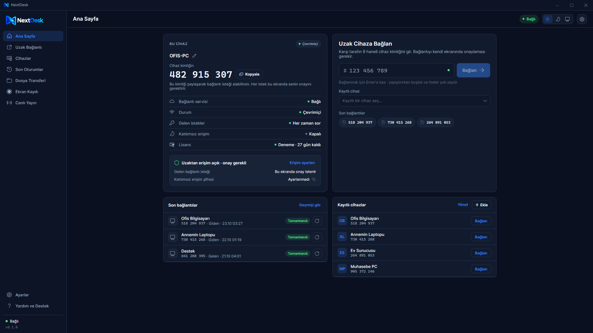
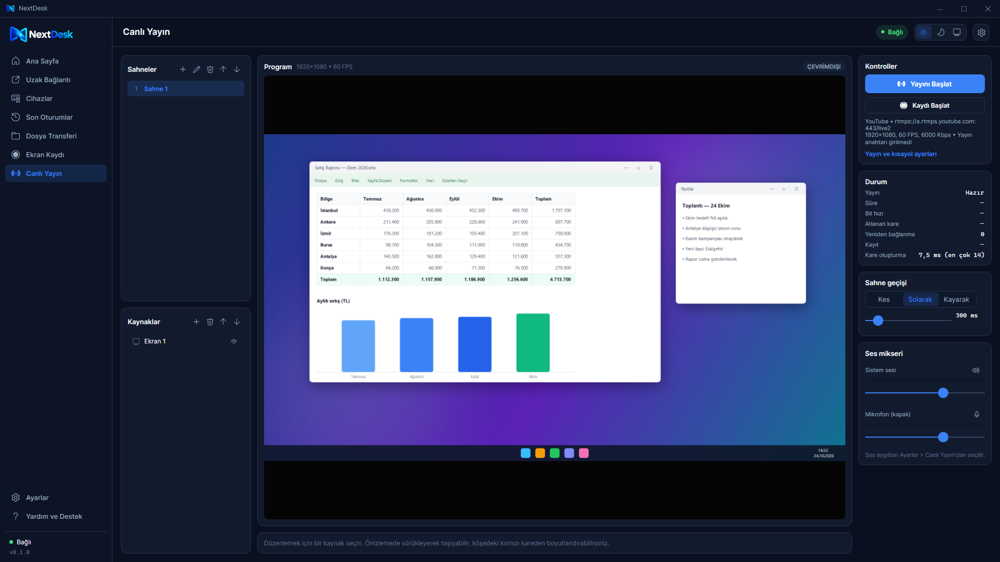
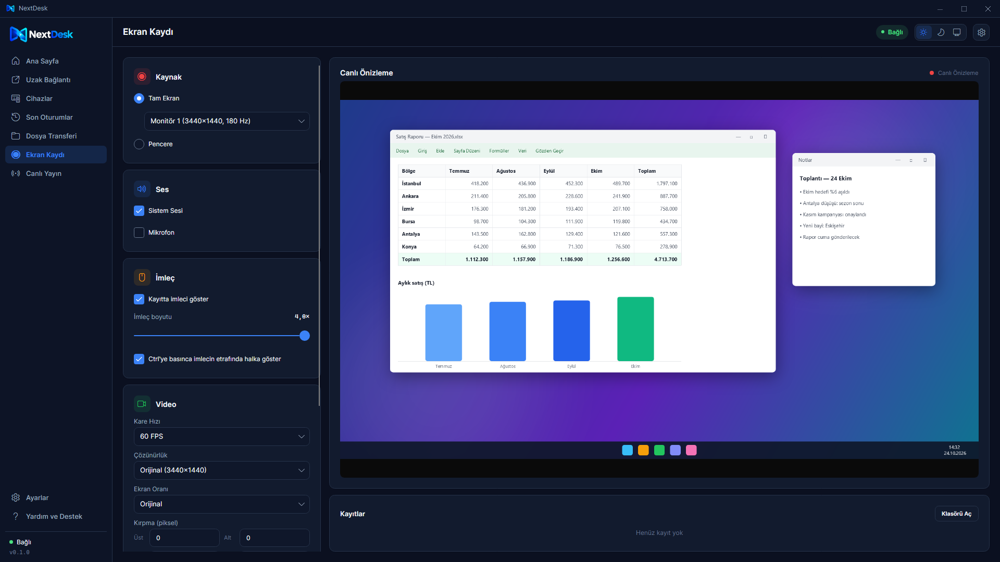
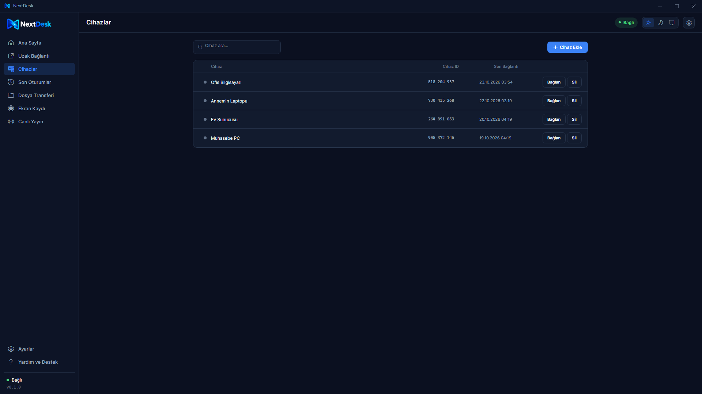
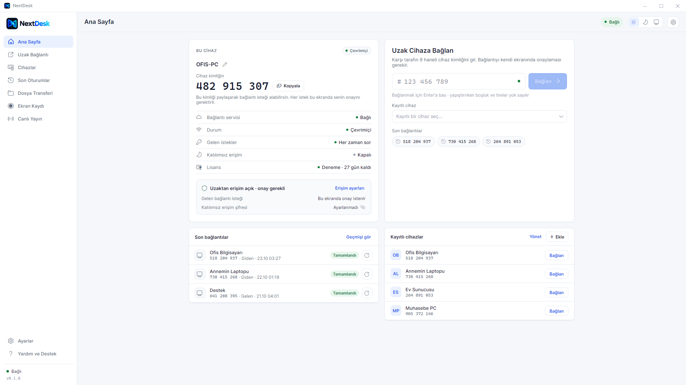

<div align="center">

<picture>
  <source media="(prefers-color-scheme: dark)" srcset="docs/logo-wordmark-on-dark.png">
  
</picture>

### Masaüstüne erişin, her yerden.

Uzak masaüstü, dosya aktarımı, sohbet ve toplantı — uçtan uca şifreli, her bağlantı sizin onayınızla.


**[⬇️ NextDesk'i indir](../../releases/latest)** · [nextdesk.tr](https://nextdesk.tr) · [Gizlilik](https://nextdesk.tr/gizlilik-politikasi/) · [Öneri ve destek](https://nextdesk.tr)

</div>

---

<p align="center">
  
</p>

## İçindekiler

- [Özellikler](#özellikler)
- [İndirme ve kurulum](#i̇ndirme-ve-kurulum)
- [Nasıl kullanılır](#nasıl-kullanılır)
- [Güvenlik](#güvenlik)
- [Planlar](#planlar)
- [Ekran görüntüleri](#ekran-görüntüleri)
- [Sık sorulan sorular](#sık-sorulan-sorular)
- [Yol haritası](#yol-haritası)
- [Destek](#destek)
- [English](#english)

## Özellikler

| | |
|---|---|
| 🖥️ **Uzak masaüstü** | 9 haneli cihaz kimliğiyle saniyeler içinde bağlanın; ekranı görün, fare ve klavyeyi kullanın. Çoklu monitör desteği. |
| ✅ **Onaylı bağlantı** | Her bağlantı karşı tarafın ekranında onaya sunulur. İsteğe bağlı, parolalı katılımsız erişim. |
| 🔒 **Uçtan uca şifreleme** | Ekran, klavye, dosya, ses ve kamera iki cihaz arasında, sertifikası doğrulanmış TLS ile taşınır. |
| 🌐 **Port açmaya gerek yok** | Aynı ağda doğrudan, internette mümkünse doğrudan (UPnP), değilse şifreli aktarıcı üzerinden bağlanır. |
| 📁 **Dosya aktarımı** | Oturum içinde dosya gönderme; SHA-256 bütünlük kontrolü, alıcı onayı. Pano paylaşımı. |
| 💬 **Sohbet ve toplantı** | Oturum içi sohbet, iki yönlü mikrofon, kamera ve sistem sesi. |
| 🎬 **Ekran kaydı** | Monitör ya da pencere kaydı, sistem sesi ve mikrofon, logo/yazı katmanı, MP4 çıktı. |
| 📡 **Canlı yayın stüdyosu** | Sahneler, geçişler, ekran/görsel/yazı/video kaynakları, chroma key; Twitch, YouTube, Kick ve özel RTMP(S). |
| 🗂️ **Cihazlar ve geçmiş** | Kayıtlı cihazlar, Wake-on-LAN, oturum geçmişi ve güvenlik kayıtları. |
| 🎨 **Açık ve koyu tema** | Sistem temasını izler ya da elle seçilir. |

## İndirme ve kurulum

1. **[Son sürümü indirin](../../releases/latest)** → `NextDesk.exe` (tek dosya, kurulum gerektirmez).
2. İsterseniz dosyanın bozulmadığını doğrulayın; PowerShell'de çıkan değer sürüm sayfasındaki `NextDesk.exe.sha256` ile aynı olmalı:
   ```powershell
   Get-FileHash .\NextDesk.exe -Algorithm SHA256
   ```
3. `NextDesk.exe`'yi çalıştırın.

> [!NOTE]
> **"Windows kişisel bilgisayarınızı korudu" uyarısı:** Beta sürüm henüz dijital olarak imzalanmadığı için Windows SmartScreen ilk açılışta uyarı verebilir. **Ek bilgi → Yine de çalıştır** ile devam edebilirsiniz. Microsoft Store sürümü Microsoft tarafından imzalanır ve bu uyarıyı göstermez.

> [!TIP]
> **Güvenlik duvarı:** İlk açılışta Windows, NextDesk'in ağ bağlantılarına izin isteyebilir. Doğrudan (daha hızlı) bağlantılar için **özel ağlarda** izin verin. İzin vermezseniz bağlantılar aktarıcı üzerinden yine çalışır.

**Sistem gereksinimleri:** Windows 10 (1809 ve sonrası) ya da Windows 11, x64, DirectX 11 destekli ekran kartı, 2 GB bellek.

## Nasıl kullanılır

1. **İndirin ve açın.** Ana sayfada bu bilgisayarın 9 haneli **cihaz kimliği** görünür.
2. **Kimliği paylaşın.** Bağlanacak kişiye kimliğinizi verin ya da onun kimliğini isteyin.
3. **Bağlanın.** Karşı tarafın kimliğini yazıp **Bağlan**'a basın; karşı taraf kendi ekranında **onaylayınca** oturum başlar.

Oturum sırasında üst çubuktan sohbet, mikrofon, kamera, dosya aktarımı ve tam ekran kullanılabilir; **Bağlantıyı Kes** her iki tarafta da her zaman açıktır.

## Güvenlik

- **Onay olmadan bağlantı yok.** Her istek bağlanılan bilgisayarda onaya sunulur. Katılımsız erişim varsayılan olarak kapalıdır; yalnızca cihaz sahibi açıp parola belirleyebilir (parola Argon2id ile özetlenir, düz metin saklanmaz).
- **Uçtan uca şifreli oturum.** Cihazlar birbirini sinyal sunucusundan alınan tek kullanımlık oturum anahtarı ve sertifika parmak iziyle doğrular; aktarıcı yalnızca şifreli baytları iletir, içeriği göremez.
- **Sunucuda oturum içeriği yok.** Ekran, dosya, ses ve sohbet sunucularımızda saklanmaz.
- **Yerel sırlar şifreli.** Cihaz anahtarı, hesap anahtarı ve yayın anahtarları Windows'un kullanıcıya özel şifrelemesiyle (DPAPI) korunur.
- **Kötüye kullanıma karşı.** Başarısız giriş ve bağlantı denemeleri sınırlanır ve güvenlik kayıtlarına yazılır.

Bir güvenlik açığı bulduysanız lütfen herkese açık bir yerde paylaşmak yerine [nextdesk.tr](https://nextdesk.tr) üzerinden bize ulaşın.

## Planlar

| | Free | Pro | Kurumsal |
|---|---|---|---|
| Uzak masaüstü, sohbet, sesli konuşma | ✅ | ✅ | ✅ |
| Bağlı cihaz | 2 | 3 | 5 + ek cihaz |
| Oturumdaki kişi (bağlanan dahil) | 2 | 4 | 4 |
| Görüntülü konuşma (kamera) | — | ✅ | ✅ |
| Kayıt ve canlı yayın kalitesi | 1080p 30 FPS | 4K 60 FPS | Sınırsız |
| Dosya aktarımı | Dosya başına 1 GB | Sınırsız | Sınırsız |
| Ticari kullanım | — | ✅ | ✅ |
| Öncelikli destek | — | — | ✅ |
| Fiyat | 0 ₺ | 300 ₺ / ay (Türkiye) · 30 $ / ay | Yakında |

Yeni kurulumlar **30 gün** boyunca hesap açmadan Free özellikleriyle kullanılabilir; sonrasında [nextdesk.tr](https://nextdesk.tr) üzerinden ücretsiz üye olup cihazınızı hesabınıza bağlamanız gerekir. Pro ve Kurumsal satın alma yakında [nextdesk.tr/fiyatlar](https://nextdesk.tr/fiyatlar/) üzerinden açılacak.

## Ekran görüntüleri

| | |
|---|---|
|  |  |
| **Ana sayfa** | **Canlı yayın stüdyosu** |
|  |  |
| **Ekran kaydı** | **Kayıtlı cihazlar** |
|  |  |
| **Açık tema** | **Uzak oturum** |

<sub>Görüntülerdeki cihaz adları, numaraları ve masaüstü içeriği örnektir.</sub>

## Sık sorulan sorular

<details>
<summary><b>Modemde port açmam ya da ayar yapmam gerekiyor mu?</b></summary>

Hayır. NextDesk önce doğrudan bağlanmayı dener (aynı ağ, UPnP); olmazsa şifreli aktarıcı sunucumuz üzerinden bağlanır.
</details>

<details>
<summary><b>Karşı taraf onay vermeden bilgisayarıma bağlanılabilir mi?</b></summary>

Hayır. Tek istisna, sizin açıp parola belirlediğiniz katılımsız erişimdir; o durumda da parolayı bilmeyen bağlanamaz ve başarısız denemeler kaydedilir.
</details>

<details>
<summary><b>Antivirüsüm NextDesk'i işaretledi.</b></summary>

Uzak masaüstü programları (ekran yakalama ve uzaktan kontrol yaptıkları için) bazı antivirüslerde yanlışlıkla işaretlenebilir. Dosyayı yalnızca bu sayfadan ya da nextdesk.tr'den indirin ve SHA-256 özetini doğrulayın. Yanlış alarmları ilgili antivirüs firmasına bildirebilirsiniz.
</details>

<details>
<summary><b>Kayıt ve kamera özellikleri neden bir şey indirmek istiyor?</b></summary>

Ekran kaydı ve kamera, açık kaynaklı FFmpeg aracını kullanır. İlk kullanımda onayınızla indirilir (~200 MB) ve SHA-256 ile doğrulanır.
</details>

<details>
<summary><b>Mac, Linux ya da telefon sürümü var mı?</b></summary>

Şimdilik yalnızca Windows. Tarayıcıdan bağlanma ve diğer platformlar yol haritasında.
</details>

<details>
<summary><b>Kaynak kodu açık mı?</b></summary>

Hayır. NextDesk tescilli bir yazılımdır; bu depo yalnızca sürümleri, belgeleri ve hata bildirimlerini barındırır.
</details>

## Yol haritası

**v1.0** (hesap ve lisans sistemi yayına girince):

- [ ] nextdesk.tr hesabı, 30 günlük deneme, Pro ve Kurumsal satın alma
- [ ] Otomatik güncelleme
- [ ] Güvenilir cihazlar — evdeki bilgisayarınıza dışarıdan onaysız bağlanma
- [ ] Windows açılınca başlatma ve kilit ekranı erişimi
- [ ] Uzaktan uyandırma (evde açık bir cihaz üzerinden)
- [ ] VDS'ler için RDP tüneli — 3389 portu internete kapalıyken güvenli bağlantı
- [ ] Tarayıcıdan bağlanma (program kurmadan, telefondan da)
- [ ] Microsoft Store

## Destek

Hata bildirimi, öneri, istek ve destek için **[nextdesk.tr](https://nextdesk.tr)** üzerinden bize ulaşın. Öneri ve istek sayfası yakında sitede açılacak.

---

## English

**NextDesk** is a remote desktop app for Windows 10/11: remote control, file transfer, chat, voice meetings, camera, screen recording and a live-streaming studio. Every connection needs the approval of the person at the other computer (optional password-protected unattended access), and session content is end-to-end encrypted between the two devices — our relay only forwards encrypted bytes. No port forwarding is needed.

**[Download the latest release](../../releases/latest)** (single `NextDesk.exe`, no installation; the UI is in Turkish). As this beta is not code-signed yet, Windows SmartScreen may warn on first launch: choose **More info → Run anyway**. Verify the download with `Get-FileHash .\NextDesk.exe -Algorithm SHA256` against `NextDesk.exe.sha256`.

NextDesk is proprietary software; this repository hosts releases and documentation only. For support, suggestions and security reports, please contact us through **[nextdesk.tr](https://nextdesk.tr)**.

---

<p align="center"><sub>© 2026 NextDeskTR. Tüm hakları saklıdır.</sub></p>
